# Visual guide: the KUEC /crm prototype and the spike, with screenshots

A walkthrough of what was built on 2026-10-18 and what each screen is for. Every image is a real capture from the running prototype (`prototype/`, Chromium 141, Gulf time zone) or from the spike inside Twenty 2.48.0. Names and companies are invented. The prototype is design validation on an in-memory store; it is not connected to Twenty and nothing here is implemented in uVENTURE.

Run it yourself: `cd kuec/design/prototype && npm install && npm run dev`, then open `http://localhost:3100/crm`. Switch person and language from the avatar menu or by URL (`?as=bd1|bd2|ed|ops|eng1|eng2`, `?lang=en|ar`).

Note on the phone captures: they are full-page screenshots, so the fixed bottom bar appears once in the middle of the image where the first viewport ended. On a real phone it stays pinned to the bottom.

## 1. Today for a BD officer (desktop, 1440 px)

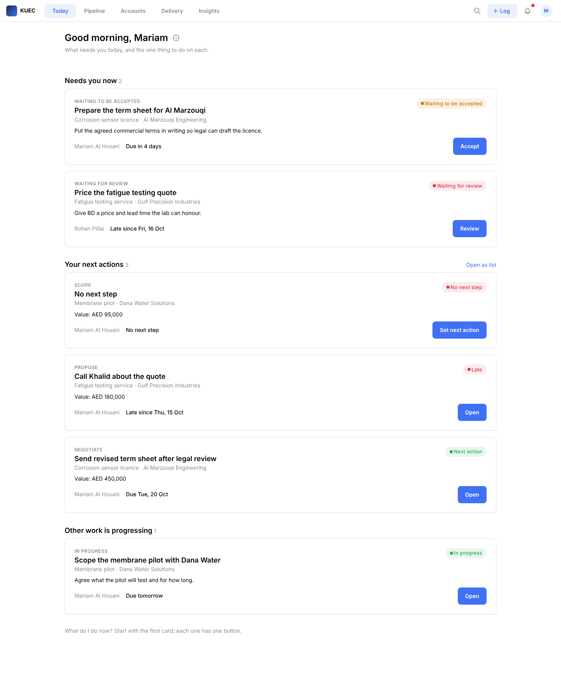

What to notice:

- The header has the five destinations, search, **Log**, the inbox bell and the person menu. Twenty's sidebar, views and object names are gone.
- The greeting is the page title; the subtitle says what the page is for. The info icon opens the five-line "How this works" in the user's language only.
- Three sections in a fixed order: **Needs you now** (work offered to me and work waiting for my review), **Your next actions** (my cases with a next action due within 7 days, or missing one), **Other work is progressing**.
- Each card carries at most six facts: title, case and company, one line of context, owner, deadline, status in plain words. One filled button per card, named after the action (Accept, Review, Set next action, Open).
- Status words are the glossary's words ("Waiting to be accepted"), never the system values ("OFFERED"). Colour is semantic only: amber waiting, red late, green on track.
- A case with no next step is shown as a red card with "Set next action" as the only button, which is the rule the cadence enforces.
- The page ends with "What do I do now?" as every screen must.

## 2. Today for the ED (desktop)

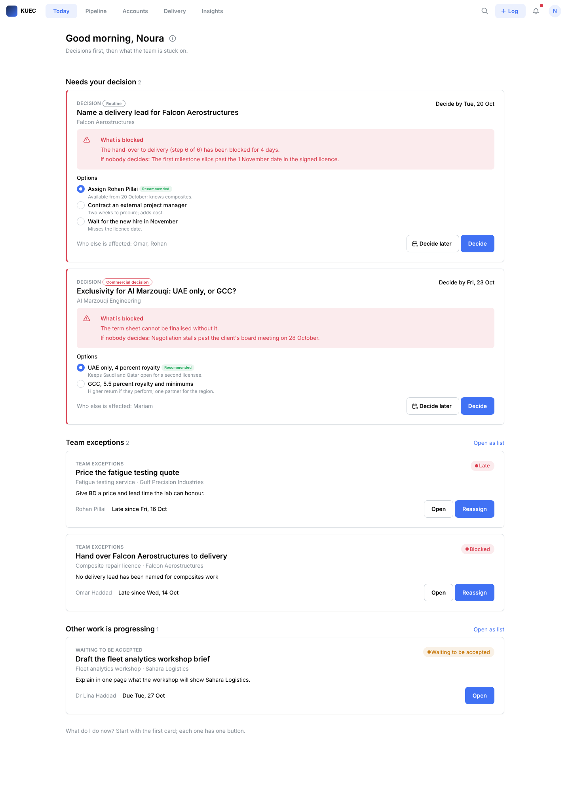

What to notice:

- **Needs your decision** comes first. Each decision card carries what is blocked, what happens if nobody decides, the options with the recommended one marked, the decide-by date, who else is affected, and **Decide later** with a date.
- The small badge separates a **Routine** decision (name a delivery lead) from a **Commercial decision** (exclusivity and royalty), so the ED tells them apart on sight.
- **Team exceptions** follows: late and blocked work across the team with the owner named and Reassign as the primary action. The ED never opens a record to find out why something is late.
- Other people's work in progress is last and collapsed to three cards with "Open as list".

## 3. Today for the operations coordinator (desktop)

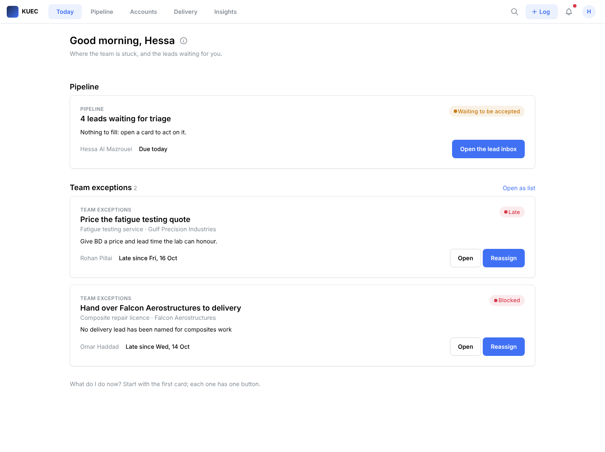

The lead inbox count is the first card (her Monday starts there), then the team exceptions she can reassign.

## 4. The Work Package card, offered, opened from a notification (desktop)

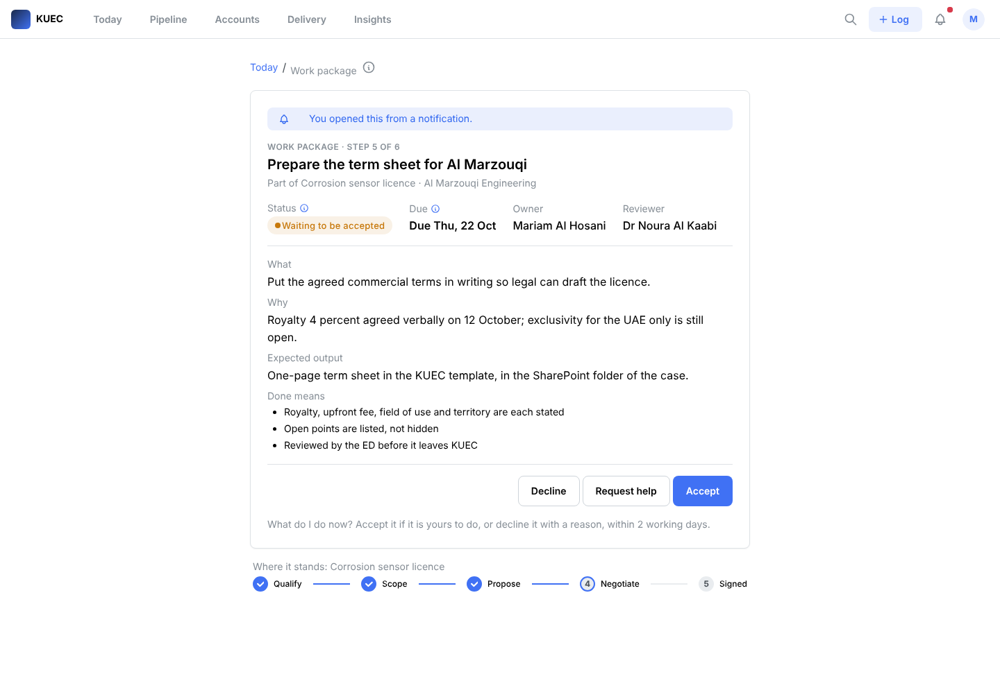

What to notice:

- The card is the first thing under the breadcrumb on every width. The banner says it was opened from a notification, which is the deep link every notification carries.
- Fixed order of facts: step of the playbook, title, which case and company, then status, due date, owner, reviewer, then What, Why, Expected output, Done means.
- Only the actions this role and status allow: the owner of an offered package sees Accept (primary), Request help and Decline. Nothing else.
- Info icons sit beside Status and Due, one tab stop each.
- Below the card, "Where it stands" shows the agreed stages only (Qualify, Scope, Propose, Negotiate, Signed).
- The last line answers "What do I do now?" for this exact state.

## 5. The same card as a reviewer (desktop)

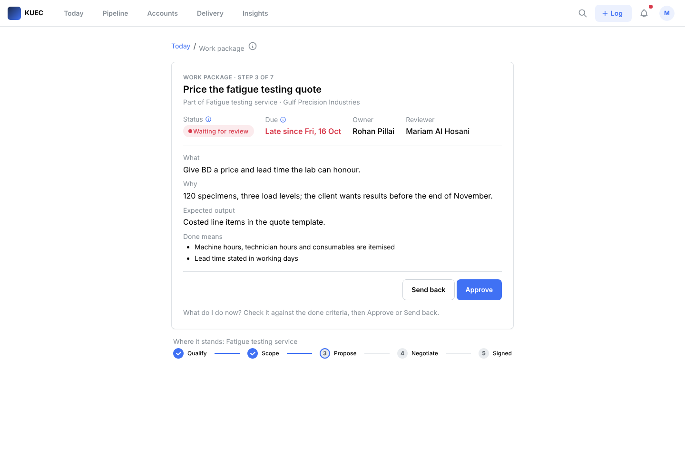

The BD officer is the reviewer of a submitted package, so the actions become **Approve** (primary) and **Send back**; the closing line tells her to check it against the done criteria. Reviewers cannot do this on the card today (audit U9).

## 6. Phone, 390 px

| Today | Work package card |
| --- | --- |
| 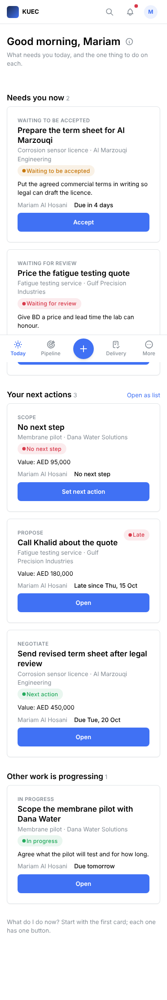 | 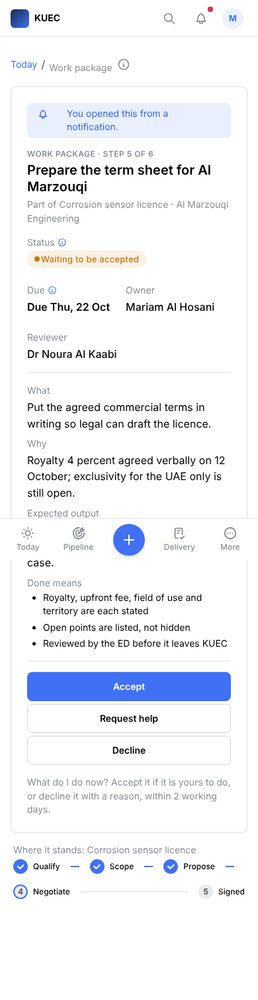 |

What to notice:

- Bottom bar: Today, Pipeline, the raised **Log** button in the centre, Delivery, More.
- Every action is full width and at least 44 px tall, stacked with the primary on top (the audit measured 26 px buttons at 2,414 px down the page today).
- The card is first; nothing scrolls before it.
- Status badges wrap instead of clipping on a narrow card.

## 7. Arabic

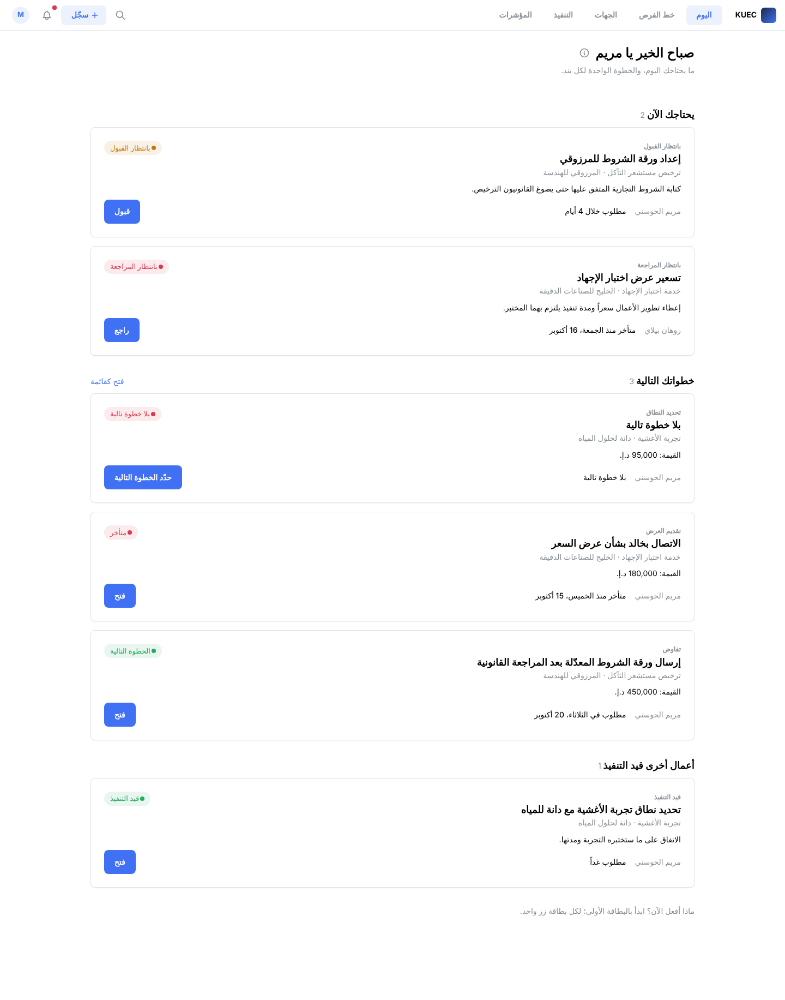

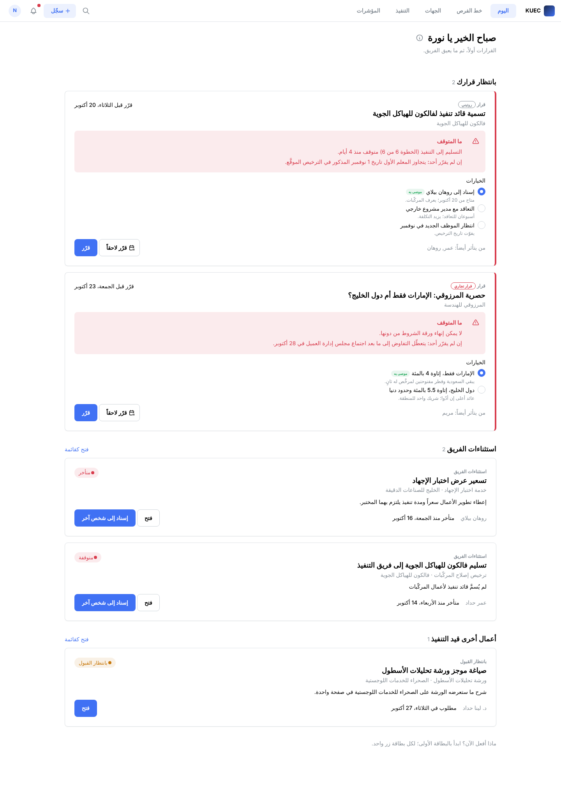

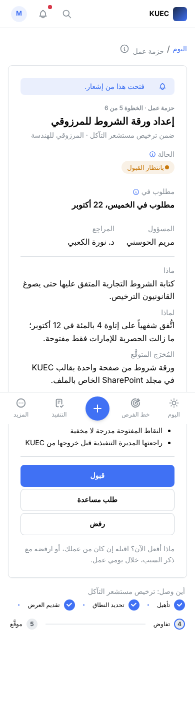

What to notice:

- One language at a time; the whole page, header and bottom bar mirror under `dir="rtl"`.
- Dates are Gregorian with Western digits in Gulf time ("الخميس، 22 أكتوبر"), which fixes the Hijri dates the audit found (U6). Amounts read "د.إ." with Western digits.
- Latin names and company names inside Arabic sentences are bidi-isolated so they do not break the line.
- Status words, buttons and the five lines all come from `glossary.md`; rows marked Draft there still need a native-speaking colleague before any test.
- The Arabic font is the system fallback in these captures; the proposed face is in `theme.md`.

## 8. Technical contributor (phone) and tablet

| Technical contributor, phone | Today, 768 px |
| --- | --- |
| 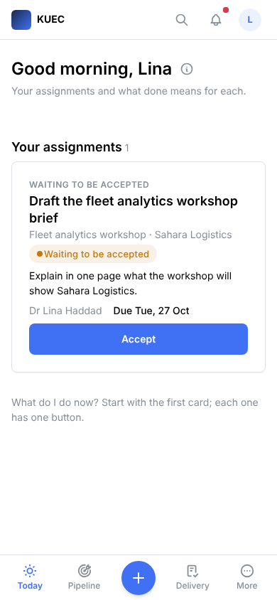 | 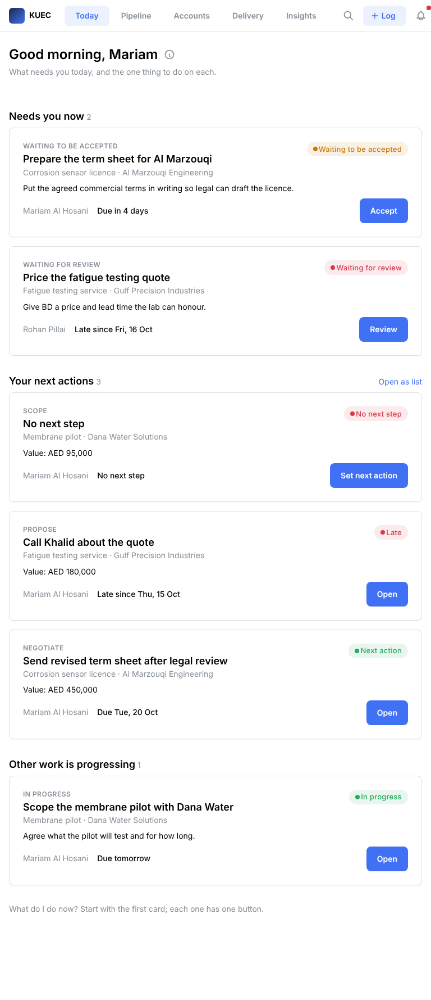 |

A faculty contributor sees only her assignment and accepts it from the card; she never meets a field, a view or the CRM's administration.

## 9. The failure path (verified, no screenshot)

With "Simulate a backend failure on the next write" switched on in the avatar menu, pressing Accept on the offered package showed "That didn't save. Nothing was changed. Try again.", the status stayed "Waiting to be accepted" and the button re-enabled. With the switch off, Accept moved the status to "In progress", the buttons changed to Request help and Submit, and the closing line changed to "Do the work, then Submit with a link to the output." Observed through Playwright on 2026-10-18. This is principle 15: nothing shows as done that the backend did not confirm.

## 10. Automated checks on these captures

From `prototype-shots/checks.json`, produced by `prototype/scripts/screenshots.mjs`:

| Capture | Direction | Filled buttons in first viewport | Smallest action height | Horizontal overflow | Console errors |
| --- | --- | --- | --- | --- | --- |
| 01 Today, BD officer, 1440 | ltr | 3 (one per card) | 36 px | none | 0 |
| 02 Today, ED, 1440 | ltr | 1 | 36 px | none | 0 |
| 03 Today, ops coordinator, 1440 | ltr | 3 | 36 px | none | 0 |
| 04 Card offered, 1440 | ltr | 1 | 36 px | none | 0 |
| 05 Card review, 1440 | ltr | 1 | 36 px | none | 0 |
| 06 Today, phone 390 | ltr | 1 | 44 px | none | 0 |
| 07 Card offered, phone 390 | ltr | 0 (below the fold) | 44 px | none | 0 |
| 08 Today, Arabic, 1440 | rtl | 3 | 36 px | none | 0 |
| 09 Card, Arabic, phone 390 | rtl | 0 | 44 px | none | 0 |
| 10 Today, ED, Arabic, 1440 | rtl | 1 | 36 px | none | 0 |
| 11 Technical contributor, phone 390 | ltr | 1 | 44 px | none | 0 |
| 12 Today, tablet 768 | ltr | 3 | 36 px | none | 0 |

Desktop header buttons are 36 px, which is standard for pointer input; the 44 px rule applies to touch.

## 11. The spike: Mantine inside Twenty's front component runtime

These four captures are why the employee experience is built in uVENTURE and not as Twenty front components. Details and source citations are in `spike-mantine-in-twenty.md`.

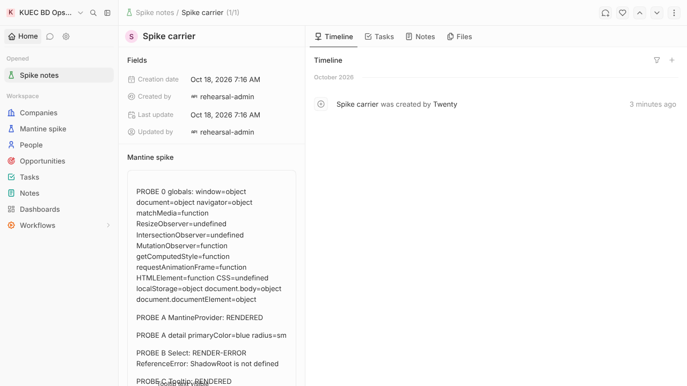

The spike widget on a record page. The first paragraph lists the sandbox globals: `ResizeObserver`, `IntersectionObserver` and `CSS` are undefined. Probe B (Select) and probe G (ScrollArea) failed to render.

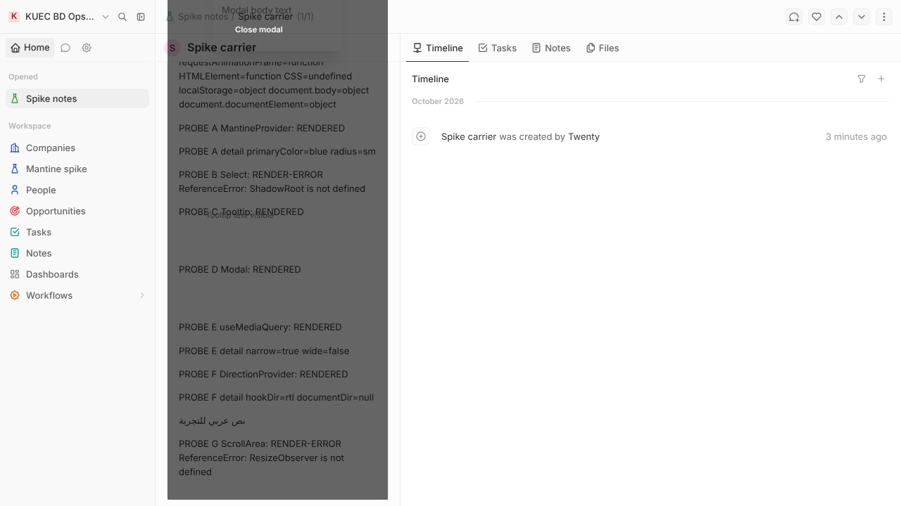

A Mantine Modal opened from the widget. The overlay covers only the widget's column and the dialog is pushed above the top of the page: portals are confined to the widget plus 200 px.

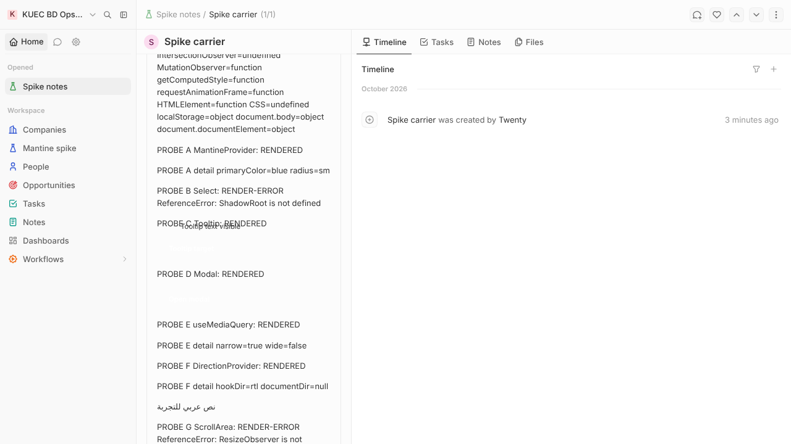

Probes C to G. The Tooltip and the two Buttons are invisible (white text on transparent) because Mantine's colour variables are scoped to a document attribute the sandbox cannot set on the real page.

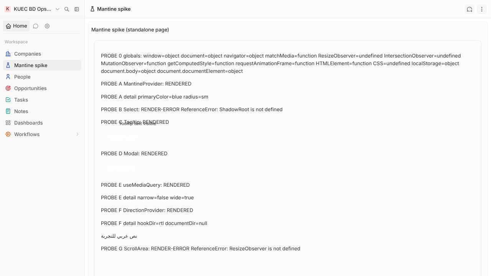

The same widget on a standalone page: `useMediaQuery('(max-width: 768px)')` now answers `false` where it answered `true` on the record page at the same 1280 px window, because the polyfill measures the widget, not the viewport.

## 12. What is not in the prototype

Pipeline, Accounts, Delivery, Insights, the Log form, the inbox and Help open a "Not in this prototype yet" page. Those screens are specified in `ia.md` and `components.md` and are scheduled in `redesign-backlog.md`. No user has tested any screen yet; the protocol is in `test-protocol.md`.
